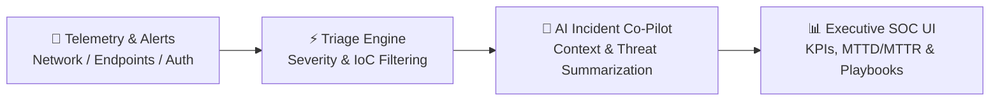

<div align="center">

# 🛡️ SentinelAI — SOC Security Dashboard
### AI-Powered Security Operations Center (SOC) Monitoring & Threat Intelligence
*Dashboard de Monitoramento de Operações de Segurança (SOC) e Inteligência de Ameaças com IA*

[](https://sentinelai-soc-dashboard.netlify.app/)
[](https://react.dev/)
[](https://www.typescriptlang.org/)
[](https://tailwindcss.com/)
[](#)

[🚀 Live Application](https://sentinelai-soc-dashboard.netlify.app/) • [🧠 Architecture](#-architecture-flow) • [🇺🇸 English](#-english) • [🇧🇷 Português](#-português) • [🧩 AI Builder Portfolio](#-ecossistema-de-projetos-trilha-ai-builder--5-soluções)

</div>

---

## 🧠 Architecture Flow



---

## 🇺🇸 English

### 📌 Overview
**SentinelAI** is a modern Security Operations Center (SOC) interface engineered for real-time threat monitoring, alert triage, and AI-assisted incident analysis. Built with a focus on operational clarity and rapid response under pressure, the dashboard simulates how analysts track security events, correlate Indicators of Compromise (IoCs), and leverage Generative AI to accelerate containment.

🔗 **Live Application:** [sentinelai-soc-dashboard.netlify.app](https://sentinelai-soc-dashboard.netlify.app/)

### ✨ Core Capabilities

| Module | Operational Focus | Technical Highlights |
| :--- | :--- | :--- |
| **Real-Time Threat Overview** | Executive situational awareness | Tracks active incidents, severity distribution, and **MTTD / MTTR** metrics |
| **AI Incident Co-Pilot** | Accelerated decision-making | Automated threat summarization, log interpretation, and mitigation steps |
| **Alert Triage & Filtering** | Noise reduction in high-volume queues | Dynamic filtering by severity (*Critical, High, Medium, Low*), status, and vector |
| **Network & Endpoint Telemetry** | Perimeter and host visibility | Monitoring of anomalous traffic, blocked IPs, and brute-force attempts |
| **24/7 Dark-Mode Ergonomics** | Shift-ready NOC/SOC usability | High-contrast dark palette designed to minimize eye strain during long shifts |

### 🛠️ Tech Stack
* **Frontend:** React, TypeScript
* **Styling & UI:** Tailwind CSS, Lucide React Icons
* **Build & CI/CD:** Vite + Continuous Deployment via GitHub & Netlify

### 🚀 Running Locally

```bash
# 1. Clone the repository
git clone [https://github.com/Rafael777Trajano/sentinelai-soc-dashboard.git](https://github.com/Rafael777Trajano/sentinelai-soc-dashboard.git)

# 2. Navigate to the project directory
cd sentinelai-soc-dashboard

# 3. Install dependencies
npm install

# 4. Start the development server
npm run dev
```

---

## 🇧🇷 Português

### 📌 Visão Geral
O **SentinelAI** é uma interface moderna de **Centro de Operações de Segurança (SOC)** projetada para monitoramento de ameaças em tempo real, triagem de alertas e análise de incidentes assistida por Inteligência Artificial. Desenvolvido com foco em clareza operacional e tomada de decisão sob pressão, o painel simula como analistas correlacionam Indicadores de Comprometimento (IoCs) e utilizam IA Generativa para acelerar a resposta a incidentes.

🔗 **Aplicação no Ar:** [sentinelai-soc-dashboard.netlify.app](https://sentinelai-soc-dashboard.netlify.app/)

### ✨ Funcionalidades Principais

| Módulo | Foco Operacional | Destaques Técnicos |
| :--- | :--- | :--- |
| **Visão Executiva de Ameaças** | Consciência situacional em tempo real | Indicadores de incidentes ativos, distribuição de severidade e métricas **MTTD / MTTR** |
| **Copiloto de Incidentes com IA** | Agilidade na análise e contenção | Resumo automatizado de ameaças, interpretação de eventos e recomendações práticas |
| **Triagem & Filtros Dinâmicos** | Redução de ruído em filas críticas | Filtragem rápida por severidade (*Crítica, Alta, Média, Baixa*), status e categoria |
| **Telemetria de Rede & Endpoints** | Visibilidade de perímetro e hosts | Monitoramento de tráfego anômalo, IPs bloqueados e tentativas suspeitas de acesso |
| **Interface Dark-Mode 24/7** | Ergonomia para turnos operacionais | Paleta escura de alto contraste projetada para ambientes contínuos de NOC/SOC |

### 🛠️ Stack Tecnológica
* **Frontend:** React, TypeScript
* **Estilização & UI:** Tailwind CSS, Lucide React Icons
* **Build & Deploy:** Vite + Integração Contínua via GitHub & Netlify

### 🚀 Como Executar Localmente

```bash
# 1. Clone o repositório
git clone [https://github.com/Rafael777Trajano/sentinelai-soc-dashboard.git](https://github.com/Rafael777Trajano/sentinelai-soc-dashboard.git)

# 2. Acesse o diretório do projeto
cd sentinelai-soc-dashboard

# 3. Instale as dependências
npm install

# 4. Inicie o servidor de desenvolvimento
npm run dev
```

---

## 🧩 Ecossistema de Projetos (Trilha AI Builder — 5 Soluções)

Este repositório faz parte de uma suíte de **5 projetos práticos** focados em **Automação de Processos, Orquestração de IA e Eficiência Operacional**:

| # | Projeto | Foco Técnico | Status |
| :---: | :--- | :--- | :---: |
| **01** | [**SentinelAI SOC Dashboard**](https://sentinelai-soc-dashboard.netlify.app/) *(Este repositório)* | Monitoramento SOC, visualização de alertas e triagem de segurança | ✅ No Ar |
| **02** | [**NetPulse AI Orchestrator**](https://orquestrador-multi-agente-de-logs-dia.netlify.app/) | Orquestração multi-agente para logs de redes, diagnóstico OSI e SecOps | ✅ No Ar |
| **03** | **Unstructured-to-JSON Engine** | Extração estruturada de dados e classificação operacional a partir de textos livres | 🚧 Em Desenvolvimento |
| **04** | **Zero-Backend Webhook Connector** | Integração ágil de eventos operacionais via webhooks (`n8n` / `Make` / `Zapier`) | ⏳ Em Breve (Roadmap) |
| **05** | **OpsProtocol RAG Copilot** | Copiloto de conformidade, consulta rápida a POPs e mediação de crises em tempo real | ⏳ Em Breve (Roadmap) |

---

<div align="center">

### 👨‍💻 Desenvolvido por **Rafael Trajano**
*Tecnólogo em Redes de Computadores • Graduando em Sistemas de Informação*  
**AI Builder | Orquestração de Agentes | Automação de Sistemas | Segurança da Informação**

[](https://www.linkedin.com/in/rafaatrjnbpbs47)
[](https://github.com/Rafael777Trajano)

</div>
